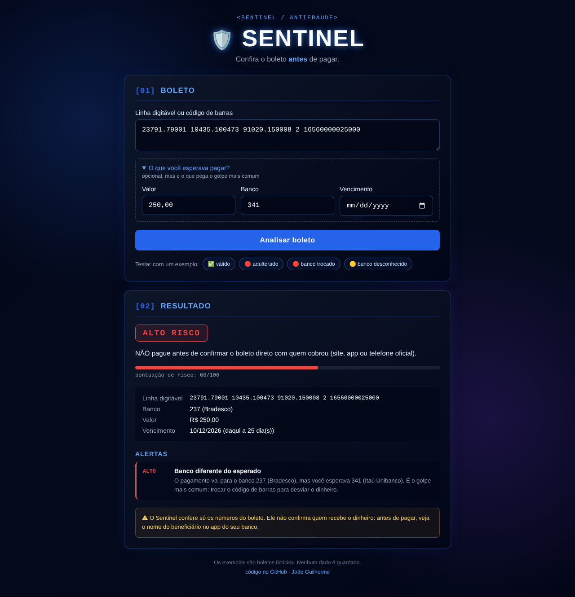

# 🛡️ Sentinel


### ▶ [Testar online: sentinel-5gi8.onrender.com](https://sentinel-5gi8.onrender.com/)

> Hospedado no plano grátis do Render: se o site estiver "dormindo", a primeira visita leva uns 30-50 segundos para abrir.

**Verificador de boletos e contas antes do pagamento.** O Sentinel lê a linha digitável (ou o código de barras) de um **boleto bancário** ou de uma **conta de consumo/tributo** (luz, água, telefone, IPTU, multas...), confere se os números são válidos e aponta sinais de fraude, explicando cada um em linguagem simples.

Funciona de dois jeitos: **pelo terminal** ou por uma **interface web** (front-end em HTML/CSS/JS conversando com uma API em Java).



> Projeto acadêmico de Ciência da Computação (ULBRA/CEULP) sobre prevenção a fraudes em pagamentos.

---

## O problema

O golpe do boleto falso funciona de dois jeitos:

1. **Adulteração "amadora":** alguém troca alguns números do boleto. Os dígitos verificadores deixam de bater.
2. **Adulteração "bem feita":** o golpista gera um código **novo e válido**, mas de outro banco/conta. Todos os dígitos batem e o boleto parece perfeito. A única forma de pegar é comparar com o que você **esperava** pagar.

O Sentinel cobre os dois casos.

## Exemplos

Golpe do boleto com banco trocado (o código é válido, mas o banco não é o que o fornecedor usa):

```text
$ sentinel 23791790011043510047391020150008216560000025000 --banco 341 --valor 250,00

============================================================
  SENTINEL - análise antes do pagamento
============================================================

Tipo            : boleto bancário
Linha digitável : 23791.79001 10435.100473 91020.150008 2 16560000025000
Banco           : 237 (Bradesco)
Valor           : R$ 250,00
Vencimento      : 10/12/2026 (daqui a 25 dia(s))

Resultado       : ALTO RISCO  (pontuação 60/100)
O que fazer     : NÃO pague antes de confirmar direto com quem cobrou (site,
                  app ou telefone oficial).

Alertas:
  [ALTO]   Banco diferente do esperado
           O pagamento vai para o banco 237 (Bradesco), mas você esperava 341
           (Itaú Unibanco). É o golpe mais comum: trocar o código de barras
           para desviar o dinheiro.
```

Conta "de luz" falsa (na verdade o código é de telefone):

```text
$ sentinel "84630000001-1 87520221000-6 00000001234-4 56789012345-6" --tipo energia

============================================================
  SENTINEL - análise antes do pagamento
============================================================

Tipo            : conta de consumo / tributo
Linha digitável : 84630000001-1 87520221000-6 00000001234-4 56789012345-6
Segmento        : 4 (Telefone, internet e TV)
Empresa         : código 0221
Valor           : R$ 187,52
Vencimento      : não vem no código (confira na conta)

Resultado       : ALTO RISCO  (pontuação 60/100)
O que fazer     : NÃO pague antes de confirmar direto com quem cobrou (site,
                  app ou telefone oficial).

Alertas:
  [ALTO]   Tipo de conta diferente do esperado
           Você disse que é uma conta de Energia elétrica e gás, mas o código
           é de Telefone, internet e TV. Golpistas mandam contas falsas que
           se passam por contas conhecidas.
```

## O que ele verifica

| Verificação | Nível | Por quê |
|---|---|---|
| Dígitos dos campos 1, 2 e 3 (módulo 10) | 🔴 Alto | Número digitado errado ou alterado |
| Dígito verificador geral (módulo 11) | 🔴 Alto | Protege o código inteiro: banco, valor, vencimento |
| Código de moeda diferente de 9 | 🔴 Alto | Boleto em real sempre usa 9 |
| Valor diferente do esperado | 🔴 Alto | Cobrança a mais ou código trocado |
| Banco diferente do esperado | 🔴 Alto | Golpe do boleto adulterado "bem feito" |
| Banco fora da lista conhecida | 🟡 Médio | Pode ser banco pequeno… ou código inventado |
| Boleto vencido | 🟡 Médio | Boletos antigos são reaproveitados em golpes |
| Vencimento a mais de 1 ano | 🟡 Médio | Incomum, pode indicar alteração |
| Vencimento diferente do esperado | 🟡 Médio | Fatura e boleto deveriam bater |
| Boleto sem valor no código | 🔵 Baixo | O valor é digitado na hora, fácil cobrar a mais |

**Contas de consumo e tributos** (começam com 8):

| Verificação | Nível | Por quê |
|---|---|---|
| Dígitos dos 4 blocos (módulo 10 ou 11) | 🔴 Alto | Número digitado errado ou alterado |
| Dígito verificador geral | 🔴 Alto | Protege o código inteiro |
| 3ª posição diferente de 6, 7, 8 ou 9 | 🔴 Alto | Código fora do padrão dos bancos |
| Segmento inexistente (0 ou 8) | 🔴 Alto | Não existe esse tipo de conta |
| Valor diferente do esperado | 🔴 Alto | Cobrança a mais |
| Tipo de conta diferente do esperado | 🔴 Alto | Conta "de luz" que na verdade é de outra coisa |
| Empresa diferente da conta anterior | 🔴 Alto | O dinheiro pode estar indo para outra empresa |
| Segmento 9 (uso do banco) | 🟡 Médio | Não deveria aparecer numa conta enviada a você |
| Valor em moeda de referência | 🔵 Baixo | O valor não está em reais; confira na conta |
| Sem valor no código | 🔵 Baixo | O valor é digitado na hora |

O resultado final é decidido pelo alerta **mais grave**: `SEM ALERTAS`, `BAIXO RISCO`, `ATENÇÃO` ou `ALTO RISCO`.

Além dos alertas, o resultado pode trazer **observações** (ℹ), que não contam como risco: por exemplo, quando você informa banco ou vencimento numa conta de consumo (que não tem esses dados no código), o Sentinel avisa que eles foram ignorados, em vez de deixar você achar que foram conferidos.

## Como rodar

Precisa só do **Java 17 ou mais novo**. O Gradle vem junto (`gradlew`), não precisa instalar.

### Versão web

```bash
./gradlew run --args="--web"
```

Abra **http://localhost:8080** no navegador. Para usar outra porta: `--args="--web --porta 9090"`.

> Dica: com o computador e o celular no mesmo Wi-Fi, dá para abrir no celular usando o IP do computador (ex.: `http://192.168.0.10:8080`).

### Terminal

```bash
# rodar os testes
./gradlew test

# analisar um boleto
./gradlew run --args="34191.79001 10435.100473 91020.150008 7 16560000025000"

# informando o que você esperava pagar
./gradlew run --args="CODIGO --valor 250,00 --banco 341 --vencimento 10/12/2026"

# conta de consumo: tipo de conta e empresa da conta anterior
./gradlew run --args="CONTA --tipo energia --empresa 0048"

# modo interativo (ele pergunta tudo)
./gradlew run -q --console=plain
```

No Windows, use `gradlew.bat` no lugar de `./gradlew`.

### API

O front-end usa a mesma API que qualquer outro sistema pode usar:

```bash
curl -X POST http://localhost:8080/api/analisar \
     -d "codigo=23791790011043510047391020150008216560000025000" \
     -d "banco=341" -d "valor=250,00"
```

```json
{
  "classificacao": "ALTO_RISCO",
  "classificacaoTexto": "ALTO RISCO",
  "tipo": "BOLETO",
  "recomendacao": "NÃO pague antes de confirmar direto com quem cobrou (site, app ou telefone oficial).",
  "pontuacao": 60,
  "documento": {
    "linhaFormatada": "23791.79001 10435.100473 91020.150008 2 16560000025000",
    "banco": "237",
    "bancoNome": "Bradesco",
    "valor": "250.00",
    "vencimento": "2026-12-10",
    "diasParaVencer": 25
  },
  "alertas": [
    { "nivel": "ALTO", "titulo": "Banco diferente do esperado", "detalhe": "O pagamento vai para o banco 237 (Bradesco)..." }
  ],
  "observacoes": [],
  "aviso": "O Sentinel confere só os números do código..."
}
```

*(resposta resumida; `observacoes` traz avisos que não são risco, como "o banco que você informou foi ignorado" numa conta de consumo; para contas de consumo, `tipo` é `CONTA_DE_CONSUMO` e `documento` traz `segmento`, `segmentoNome`, `empresa` e `valorEmReais`)*

| Rota | O que faz |
|---|---|
| `POST /api/analisar` | Analisa boleto ou conta. Campos: `codigo` (obrigatório), `valor`, `banco`, `vencimento` (boleto), `tipo` e `empresa` (conta) |
| `GET /api/saude` | Responde `{"status":"ok"}` (para monitoramento/hospedagem) |
| `GET /` | Página web |

Erros voltam com o status certo e uma mensagem: `400` (código inválido), `405` (método errado), `413` (requisição grande demais), `429` (muitas análises em pouco tempo, com o cabeçalho `Retry-After`).

### Hospedagem (Render, grátis)

O repositório já tem tudo pronto: `Dockerfile` (imagem em duas etapas: compila com JDK, roda só com JRE) e `render.yaml` (configuração do serviço).

1. Crie uma conta em [render.com](https://render.com) entrando com o GitHub.
2. Clique em **New → Blueprint** e escolha este repositório (ou use o botão abaixo).
3. Confirme em **Apply**. Em alguns minutos o Render dá um link `https://sentinel-xxxx.onrender.com`.

[](https://render.com/deploy?repo=https://github.com/joaohaze4/Sentinel)

A cada push na `main`, o Render publica a versão nova sozinho. No plano grátis o serviço "dorme" depois de um tempo sem visitas e a primeira visita leva uns 30-50 segundos para acordar.

Para testar a imagem no seu computador (precisa de Docker):

```bash
docker build -t sentinel .
docker run -p 8080:8080 sentinel
```

### Programa que roda sozinho

```bash
./gradlew installDist
build/install/sentinel/bin/sentinel --ajuda
```

### Exemplos para testar (fictícios)

| Caso | Linha digitável |
|---|---|
| ✅ Válido (Itaú, R$ 250,00) | `34191790011043510047391020150008716560000025000` |
| 🔴 Um dígito adulterado | `34191790011073510047391020150008716560000025000` |
| 🔴 Banco trocado (use `--banco 341`) | `23791790011043510047391020150008216560000025000` |
| 🟡 Vencido | `23790928161234567890312345678903215860000189990` |
| 🟡 Banco desconhecido | `99991790061043510047391020150008516560000050000` |
| 🔵 Sem valor | `00190000090123456700400001234178916660000000000` |
| ✅ Conta de luz (R$ 187,52) | `836500000010875200480007000000012344567890123456` |
| ✅ Conta de água (módulo 11) | `828500000000943001022025612100000004004567890000` |
| 🔴 Conta de luz adulterada | `836500000010879200480007000000012344567890123456` |
| 🔴 Conta de telefone (use `--tipo energia`) | `846300000011875202210006000000012344567890123456` |

> Os exemplos usam datas de 2026. Para ver sempre o mesmo resultado, acrescente `--hoje 2026-11-15`.

## Como o código está organizado

```text
src/main/java/br/com/sentinel/
├── Main.java                  ← ponto de entrada (linha de comando)
├── HorarioBrasil.java         ← "hoje" no horário de Brasília
├── boleto/                    ← ENTENDER o código
│   ├── LeitorDeDocumento.java ← decide: boleto ou conta de consumo?
│   ├── Documento.java         ← interface selada: Boleto ou ContaDeConsumo
│   ├── LeitorDeBoleto.java    ← texto → Boleto (linha digitável ⇄ código de barras)
│   ├── Boleto.java            ← os dados separados (banco, valor, vencimento…)
│   ├── LeitorDeContaDeConsumo.java ← texto → ContaDeConsumo (48 ⇄ 44 dígitos)
│   ├── ContaDeConsumo.java    ← segmento, empresa, valor…
│   ├── Segmento.java          ← tipos de conta (energia, água, telefone…)
│   ├── DigitoVerificador.java ← módulo 10, módulo 11 e módulo 11 de arrecadação
│   ├── FatorVencimento.java   ← 4 dígitos → data (inclui a virada de 2025)
│   └── Bancos.java            ← código → nome do banco
├── analise/                   ← PROCURAR fraude
│   ├── AnalisadorDeRisco.java ← roda todas as regras e junta o resultado
│   ├── Regra.java             ← interface que toda regra implementa
│   └── regras/                ← uma classe por verificação
│       └── conta/             ← regras das contas de consumo
├── relatorio/                 ← MOSTRAR o resultado (terminal)
├── cli/                       ← ler os argumentos do terminal
└── web/                       ← servidor HTTP + API JSON
    ├── ServidorWeb.java       ← rotas, segurança e respostas
    ├── RespostaJson.java      ← Resultado → JSON
    ├── Json.java              ← escapar texto em JSON
    └── Formulario.java        ← ler o formulário enviado pelo navegador

src/main/resources/web/        ← FRONT-END
├── index.html
├── estilo.css
└── app.js                     ← chama a API com fetch() e monta o resultado
```

O fluxo é sempre o mesmo. Só muda a "porta de entrada" e a forma de mostrar:

```text
terminal ─┐                                                                  ┌─► RelatorioTexto (terminal)
          ├─► LeitorDeBoleto ─► Boleto ─► AnalisadorDeRisco ─► Resultado ─┤
navegador ┘   (via POST /api/analisar)     (roda cada Regra)              └─► RespostaJson ─► app.js (tela)
```

A regra de negócio fica **só no Java**: o front-end não sabe calcular nada, ele só mostra o que a API devolve.

**Para adicionar uma verificação nova**, crie uma classe em `analise/regras/` que implementa `Regra` e coloque-a na lista do `AnalisadorDeRisco`. Nada mais precisa mudar (padrão de projeto *Strategy*).

## Conceitos usados (para estudar)

- **Linha digitável × código de barras:** no boleto, a linha (47 dígitos) é o código de barras (44) reorganizado em 5 campos, com 3 dígitos verificadores extras. Veja `LeitorDeBoleto.linhaParaCodigoDeBarras`.
- **Contas de consumo (padrão de arrecadação):** começam com 8. A 2ª posição diz o tipo de conta, a 3ª diz se o valor está em reais e qual módulo usar (6/7 → módulo 10, 8/9 → módulo 11). A linha digitável (48) são 4 blocos de 11 dígitos + 1 DV cada. Não há banco nem vencimento padronizados no código.
- **Interface selada (`sealed`) e `instanceof` com variável:** `Documento` só pode ser `Boleto` ou `ContaDeConsumo`; o `AnalisadorDeRisco` escolhe as regras com `if (documento instanceof Boleto boleto)`.
- **Generics nas regras:** `Regra<Boleto>`, `Regra<ContaDeConsumo>` ou `Regra<Documento>` (vale para os dois, como a `RegraValor`).
- **Fuso horário:** servidores na nuvem rodam em UTC (3 h à frente do Brasil). O "hoje" é calculado em `America/Sao_Paulo` (`HorarioBrasil`), senão das 21h à meia-noite um boleto que vence hoje apareceria vencido.
- **Módulo 10 e módulo 11:** algoritmos de dígito verificador da FEBRABAN. Estão comentados passo a passo em `DigitoVerificador`.
- **Fator de vencimento:** dias desde 07/10/1997. Chegou em 9999 em 21/02/2025 e reiniciou em 1000 no dia 22/02/2025. O mesmo fator pode significar duas datas, então o Sentinel escolhe a mais próxima de hoje.
- **`record`** (Java 16+): classes só de dados (`Boleto`, `Alerta`, `Resultado`).
- **`BigDecimal`:** dinheiro nunca é guardado em `double`, porque `0.1 + 0.2` não dá `0.3` exato.
- **Testes com JUnit 5:** 117 testes em `src/test/`, incluindo testes que sobem o servidor de verdade, fazem requisições HTTP e simulam ataques. Os boletos de exemplo foram gerados por um programa separado, para os testes não conferirem o código contra ele mesmo.
- **API HTTP sem framework:** o servidor usa o `HttpServer` que já vem no Java, para dar para enxergar o que frameworks como o Spring fazem por baixo.

## Segurança da versão web

- **Sem XSS:** o `app.js` monta a tela com `textContent`, nunca com `innerHTML`, então nenhum texto vira código.
- **Content-Security-Policy:** a página só carrega scripts e estilos do próprio servidor.
- **Sem path traversal:** só uma lista fechada de arquivos pode ser baixada; `/../build.gradle` dá 404.
- **Validação por lista de permitidos:** cada campo é conferido (só números, datas válidas, tipos de conta de uma lista fechada) e as mensagens de erro nunca devolvem HTML: caracteres como `<` e `>` viram `?` (defesa contra XSS refletido, com teste para cada campo).
- **Limite de tamanho:** requisições acima de 4 KB são recusadas (`413`).
- **Limite de requisições:** 30 análises por minuto por IP e 600 por minuto no total (`429`). O limite global protege mesmo se alguém falsificar o IP no `X-Forwarded-For`, e também impede que a memória cresça sem parar.
- **Contra conexões lentas (slowloris):** o servidor fecha conexões que levam mais de 10 s para enviar a requisição ou receber a resposta, e atende 16 conexões ao mesmo tempo. Há testes que simulam o ataque, e eles falham se a proteção for desligada.
- **HSTS:** o navegador passa a usar sempre HTTPS (o Render cuida do certificado).
- **Container sem root:** a imagem Docker roda com um usuário comum, sem privilégios.
- **Sem cache e sem armazenamento:** os dados do boleto ou da conta não são salvos em lugar nenhum.

O que **não** está coberto: ataques grandes e distribuídos (DDoS) exigem proteção na infraestrutura (CDN/firewall), não na aplicação.

## Limitações (importante)

- O Sentinel confere **só os números**. Ele **não** sabe quem é o beneficiário (nome/CNPJ): essa informação fica no registro do banco. **Antes de pagar, confira o beneficiário no app do seu banco.**
- Sem os dados esperados (`--banco`, `--valor`, `--tipo`, `--empresa`), um boleto ou conta falsos **bem feitos** passam sem alertas. Eles são matematicamente válidos.
- Contas de consumo não trazem vencimento nem banco no código, então não dá para conferir isso nelas.
- O código da empresa da conta de consumo aparece como número: não existe uma lista pública oficial ligando esses códigos aos nomes das empresas.
- A lista de bancos é resumida.

Nenhuma ferramenta detecta 100% das fraudes. O Sentinel reduz o risco e explica o que conferir.

## O que o Sentinel não detecta (e por quê)

O Sentinel é um **primeiro filtro**: ele pega erro de digitação, código adulterado e o golpe do código trocado. Mas existem golpes em que **o código é real e perfeito**, e aí nenhuma ferramenta que olha só os números consegue pegar.

### 1. Boleto "real" com beneficiário falso

O golpista abre uma conta **no mesmo banco** que o fornecedor usa e registra um boleto de verdade, com o mesmo valor e vencimento. Para o Sentinel está tudo certo: dígitos válidos, banco esperado, valor esperado.

- **Por que não dá para pegar:** o que denuncia o golpe é o **beneficiário** (nome e CNPJ de quem recebe). Essa informação fica no cadastro do banco e não está nos números do boleto.
- **Como se defender:** na hora de pagar, o app do banco mostra o beneficiário, então confira o nome e o CNPJ. E se o fornecedor emite boletos no seu CPF/CNPJ, eles aparecem sozinhos no **DDA** (Débito Direto Autorizado) do seu banco: boleto que chegou por e-mail ou WhatsApp e **não aparece no DDA** merece desconfiança.

### 2. Conta de consumo verdadeira, mas de outra pessoa

Se o golpista usa o código da companhia de energia de verdade, o dinheiro vai **para a companhia**, não para ele. Então o golpe é outro: ele envia a **conta real de outra pessoa** (às vezes a dele mesmo), e a vítima acaba pagando a conta dele.

- **Por que não dá para pegar:** o número do cliente (unidade consumidora, instalação) fica no "campo livre" do código, e cada empresa organiza esse campo de um jeito, sem padrão.
- **Como se defender:** confira o **número da instalação ou do cliente** impresso na conta, ou baixe a 2ª via direto no site ou app oficial da empresa.

### Onde o Sentinel entra

```text
 1. Sentinel            → os números do código são válidos e batem com o que eu esperava?
 2. Origem do documento → veio do site/app oficial ou apareceu no DDA?
 3. App do banco        → o beneficiário (nome/CNPJ) é quem deveria receber?
```

Só a soma das três camadas dá segurança. O Sentinel cobre a primeira e lembra das outras duas em toda análise.

### Como dava para ir além

- **Consulta do beneficiário antes do pagamento:** existem sistemas que consultam os dados registrados de um boleto (beneficiário, situação), mas exigem parceria e credenciais junto a bancos. Fica como visão de futuro, por exemplo para um sistema de contas a pagar de empresas.
- **Cadastro de fornecedores com CNPJ esperado:** o Sentinel guardaria o CNPJ de cada fornecedor e mostraria "confira se o beneficiário no app é o CNPJ 12.345.678/0001-90". Ele não confirma sozinho, mas transforma um aviso genérico num passo concreto de conferência.

## Próximos passos

- [x] Contas de consumo e tributos (padrão de arrecadação, 48 dígitos)
- [x] "Hoje" no horário de Brasília (correção de fuso no servidor)
- [ ] Ler o boleto a partir do PDF
- [ ] Lista completa de bancos (tabela do Banco Central)
- [ ] Cadastro de fornecedores com CNPJ esperado
- [ ] Cadastro de fornecedores (banco e faixa de valor que cada um costuma usar)
- [x] Interface web + API HTTP
- [x] Hospedar a versão web ([sentinel-5gi8.onrender.com](https://sentinel-5gi8.onrender.com/))
- [ ] Migrar a API para Spring Boot
- [ ] Leitura do boleto em PDF/imagem
- [ ] Lista completa de bancos a partir da tabela oficial do Banco Central

---

Feito por **João Guilherme Pereira Aquino**: [portfólio](https://joaohaze4.github.io/potifolio/) · [GitHub](https://github.com/joaohaze4)
